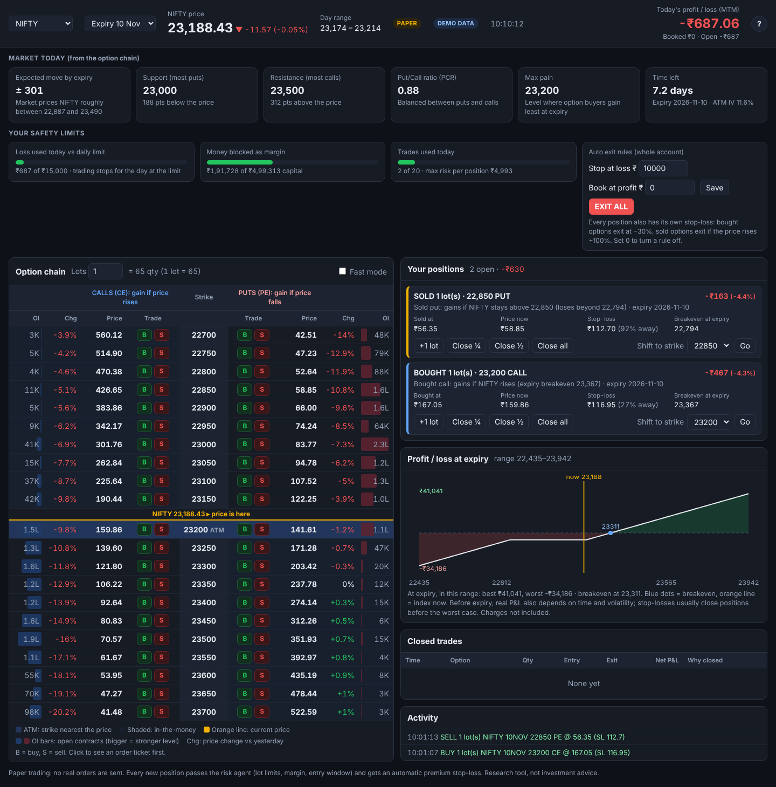
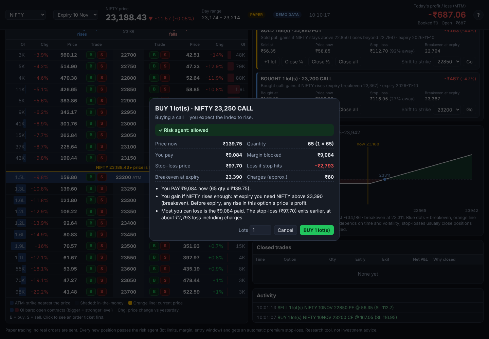

# Indian Market Trading Agents

Backtesting and paper trading for NSE/BSE **equity cash**, **index F&O** and **stock F&O**.
Rule-based strategies place trades, a risk agent sizes and guards them, and an optional
Claude AI analyst can veto trades based on news and price action.

> **No real orders are sent.** This version runs backtests and paper trading only.
> Not investment advice. Most retail F&O traders lose money (SEBI study: about 9 in 10).
> Prove a strategy on paper for months before considering live trading.

## How it works

Visual overview of a full trading day: [docs/workflow.html](docs/workflow.html) (image: [docs/workflow.png](docs/workflow.png)).

Each new candle passes through a chain of agents:

```
Market data ──► Strategy agent ──► Risk agent ──► AI analyst ──► Execution (paper broker)
 (Upstox/CSV)    ORB, EMA,          sizing, limits,   Claude: approve     fills, slippage,
                 Supertrend         kill switch       or veto only        Indian charges
```

| Agent | File | Job |
|---|---|---|
| Strategy | `tradebot/strategies/` | Turns candles into entry/exit signals with a stop-loss |
| Risk | `tradebot/risk.py` | Sizes trades (1% risk default), rounds to F&O lots, checks margin, entry window, max positions/trades, daily-loss kill switch, order-rate limit, blocks option writing and delivery shorts |
| AI analyst | `tradebot/agents/analyst.py` | Claude reviews each approved entry with web search (results, ban list, SEBI action, events). Can only **veto**, never create or resize trades |
| Execution | `tradebot/brokers/paper.py` | Simulated fills at next bar open, gap-aware stops, STT/brokerage/GST/stamp duty |
| Desk | `tradebot/agents/desk.py` | Runs the chain. The same code runs backtests and paper trading |

Strategies included:
- **orb**: Opening Range Breakout (first 15 min), stop at the other side of the range
- **ema_crossover**: EMA 9/21 cross, ATR stop, 2:1 target
- **supertrend**: Supertrend flip with trailing stop

## Claude skills (chat with it)

Open this repo in Claude Code and type a command. Each skill runs the tested Python engine,
so Claude explains the numbers instead of guessing them.

| Skill | Does | Engine command |
|---|---|---|
| `/trader-scan` | Ranks NIFTY stocks: gaps, volume spikes, breakouts, NR7, trend | `scan` |
| `/trader-research SYMBOL` | News, results, events, ban/ASM status, bulk/block deals → risk brief | `deals` + web search |
| `/trader-plan` | Qty/lots, stop, target, margin, charges, breakeven, win rate needed | `plan` |
| `/trader-backtest` | Time machine: replay past periods, honest read of results | `backtest` |
| `/trader-paper` | Run paper trading with Telegram alerts and kill switch | `paper` |
| `/trader-journal` | Review the day: P&L after charges, blocks, vetoes, one improvement | reads `runs/` |
| `/trader-live` | Real-time assistant during market hours: your positions, MTM, limits, warnings, explained | `live` |

### Real-time assistant (`/trader-live`)

While the option terminal or the strategy bot is running, open this folder in Claude Code (included in Claude Pro)
and ask *"how are my trades?"* or type `/trader-live`. Claude runs `python -m tradebot live`, which reads your live
positions, MTM, safety-limit usage and market summary, and flags risks in code (stop-loss close, short option at its
strike, daily loss limit nearly used, expiry-day decay, price at support/resistance). Claude explains them in plain
words. It is **read-only**: it never places or closes trades unless you explicitly ask for that exact action.

### Why these skills and not 11

This was inspired by an open-source US "day-trader" skill pack with 11 skills, adapted for India
rather than copied:
- **Entry, exit, budget and risk** are one engine here (`/trader-plan` and the risk agent). Separate
  skills for them could give conflicting answers.
- **News and earnings** are merged into `/trader-research`, using NSE/BSE sources.
- **"Pelosi tracker"** (US politicians' trades) has no Indian equivalent; NSE **bulk/block deals**
  replace it, shown as context only, because copying disclosed deals isn't a proven intraday edge.
- **Order executor** stays paper-only until a strategy proves itself and SEBI's retail-algo setup is done.

## Quick start

```bash
pip install -r requirements.txt
python -m tradebot demo          # synthetic data, no accounts needed
python -m pytest -q              # tests
python -m tradebot scan          # today's watchlist from free Yahoo data
python -m tradebot plan RELIANCE BUY 1400 1390   # size a trade
python -m tradebot backtest -c config/daily_yahoo.yaml   # free daily backtest
```

The demo uses **random synthetic prices**, so it should lose about what it pays in charges.
That's the expected result: on random data no strategy has an edge.

## Running the 2–3 month paper test

**One-time setup (about 30 minutes, on your PC):**
1. Install Python 3.11+, then in this folder: `python -m venv .venv`, activate it, `pip install -r requirements.txt`.
2. Upstox developer console → create an app → Redirect URL `http://127.0.0.1:5055/callback`.
3. Copy `.env.example` to `.env` and paste your Upstox **Analytics Token** after `UPSTOX_ACCESS_TOKEN=`
   (developer portal → My Apps → Analytics → Generate Token: valid 1 year, read-only, no daily login).
   Plus Telegram/Kotak/Anthropic if used.
   `.env` is git-ignored; never share it.
4. `config/my.yaml` is a ready starter (ORB on RELIANCE, HDFCBANK, ICICIBANK, INFY, SBIN; ₹5 lakh paper capital).
   Check everything with `python -m tradebot preflight` (it must say READY).
5. Test once: `python -m tradebot paper -c config/my.yaml --login -v` during market hours.
6. Schedule it for 09:00 IST on weekdays:
   - **Windows:** `schtasks /create /tn "tradebot paper" /tr "C:\path\to\Santosh\scripts\run_paper.bat" /sc weekly /d MON,TUE,WED,THU,FRI /st 09:00`
   - **Linux/macOS:** `crontab -e`, add `CRON_TZ=Asia/Kolkata` and `0 9 * * 1-5 /path/to/Santosh/scripts/run_paper.sh config/my.yaml`
   - Set the PC to never sleep during market hours.

**Every trading day (about 30 seconds):** at 09:00 the browser opens the Upstox login page. Log in (PIN/OTP),
and trading starts by itself. Upstox requires this daily login; it can't be skipped. If you miss it, the bot waits
10 minutes, then continues on Kotak Neo backup data if configured. It stops after 15:30 and sends a Telegram summary.
Logs: `runs/logs/<date>.log`. Weekends and holidays listed in the config are skipped.

**Every week:** `python -m tradebot report` (or `/trader-journal` in Claude Code). It combines all days and shows:
progress toward 100 trades, P&L after charges, win rate, profit factor, drawdown, losing streaks, results by
strategy, stock, exit reason and entry hour, and a strict verdict:

| Verdict | Meaning |
|---|---|
| NOT ENOUGH DATA | Fewer than 100 trades or 40 trading days. Keep going. |
| LOSING after charges | Don't trade real money with this setup. |
| Barely profitable | Profit factor below 1.2: too thin to survive real slippage. |
| Could be luck | Profitable, but the t-statistic is below 2. |
| PASSES | Next step: small real-money test (₹50k–1L) for 1–2 months. |

Change one thing at a time, and only after backtesting it. Changing rules mid-test resets the evidence.

## Using real data (Upstox)

Of SBI Securities, Kotak and Upstox, Upstox has the best free API, so it's the data source here.

1. Create an app at the [Upstox developer console](https://account.upstox.com/developer/apps) (free).
2. Log in daily: `python -m tradebot upstox-login` opens the browser and prints today's token
   (or use `paper --login`, which does this automatically). Tokens expire around 3:30 AM IST.
4. Find instrument keys:
   ```bash
   python -m tradebot find-key RELIANCE                  # NSE_EQ|INE002A01018
   python -m tradebot find-key NIFTY --segment NSE_FO    # futures/options keys
   ```
5. Copy `config/example.yaml`, edit instruments and strategies, then:
   ```bash
   python -m tradebot fetch    -c config/my.yaml   # save history to data/*.csv
   python -m tradebot backtest -c config/my.yaml   # results in runs/
   python -m tradebot paper    -c config/my.yaml   # live paper trading in market hours
   ```

Paper trading writes `journal.csv` (every signal, block, veto, fill) and `trades.csv` to
`runs/paper_<time>/`. **Kill switch:** create a file named `STOP` in that folder to close
everything and stop trading.

## Telegram alerts (optional)

1. On Telegram, message **@BotFather**, send `/newbot`, copy the token.
2. Send any message to your new bot, then open `https://api.telegram.org/bot<TOKEN>/getUpdates`
   and copy the `chat` → `id` number.
3. `export TELEGRAM_BOT_TOKEN=... TELEGRAM_CHAT_ID=...`, then `python -m tradebot alert-test`.
4. Set `alerts: {telegram: true}` in your config. You'll get entries, exits, AI vetoes and kill-switch alerts.

## Option trading terminal (paper)

A browser screen for manual index-option trading, like a broker's option terminal, but every order is simulated.

```bash
python -m tradebot terminal --demo     # try it now: simulated prices, no login
python -m tradebot terminal --login    # live NIFTY/BANKNIFTY/FINNIFTY/SENSEX chain from Upstox
```
Opens `http://127.0.0.1:8050` (only reachable from your own PC). Settings: `config/terminal.yaml`.



- **Market today** in plain words: expected move by expiry, support and resistance from open interest, put/call ratio,
  max pain, time left.
- **Your safety limits** as meters: loss used vs the daily limit, margin blocked, trades used; auto-exit rules and EXIT ALL.
- **Option chain** labelled "CALLS gain if price rises / PUTS gain if price falls", with OI bars, change vs yesterday,
  ATM and in-the-money shading, and an orange line where the price is.
- **Order ticket** before every trade: what you pay or receive, margin, stop-loss, loss if the stop hits, breakeven,
  charges, and the risk agent's decision (with the maximum lots allowed). "Fast mode" skips it.
- **Positions in plain language** ("Sold put: gains if NIFTY stays above 22,850"), with close ¼ / ½ / all and shift to strike.
- **Profit/loss at expiry chart** for your open positions, with breakevens. The **?** button explains every term.



Safety, the same as the strategy bot:
- Every new position and every add goes through the **risk agent**: 1% risk per position counting lots already held,
  margin (option selling uses about 12% of the index value per unit), entry window, trade and order-rate limits.
- Each position gets an automatic **premium stop-loss** (buys: −30%, sells: premium doubles). Intraday square-off at 15:15.
- With ₹5 lakh, expect about **1 lot** of NIFTY option selling (≈₹1.8 lakh margin per lot). Large short-option positions
  need large capital and can lose fast on sharp moves.

Trades are saved to `runs/terminal_<date>/`; review them with `python -m tradebot report --prefix terminal`.

## Official NSE data and news (free)

| Command | What it gets |
|---|---|
| `python -m tradebot nse-bhav --days 150` | NSE **Bhavcopy**: official end-of-day prices for every stock (cached in `data/nse/`) |
| `python -m tradebot scan --nse` | Scanner on official NSE prices instead of Yahoo |
| `python -m tradebot ban-list` | Today's **F&O ban list** |
| `python -m tradebot events INFY` | Results/board meetings, dividends/splits, latest announcements |
| `python -m tradebot news [SYMBOL]` | RSS headlines (Economic Times, Moneycontrol, Business Standard, Mint) |

In paper trading, turn on `context: {enabled: true}` and the desk will:
- block new **F&O** entries in stocks on the ban list (NSE's rule; `ban_blocks: all` also blocks cash),
- block entries in a stock on its **results / board-meeting day**,
- give the AI analyst the official events and recent headlines for that stock.

Backtests don't use this: past ban lists aren't available, and old headlines would leak hindsight.
NSE's site blocks obvious bots, so the client uses a browser-like session and pauses between calls.
If NSE changes a file format, only the small parsers in `tradebot/data/nse.py` need updating.

## Kotak Neo as the live data source (or backup)

Set `live_data: kotak` in the config (it is the default in `config/my.yaml`) to run the strategy bot on
**Kotak Neo** prices without Upstox: quotes are polled every 5 seconds and built into 5-minute candles;
earlier days' history comes from Yahoo. With `live_data: upstox`, Kotak is only the backup described below.
The option terminal's live chain still needs Upstox (it stays on demo data otherwise).

## Kotak Neo backup (optional, free for Kotak clients)

If Upstox fails 3 times in a row for a stock (expired token, outage), paper trading switches that
stock to **Kotak Neo** prices and builds 5-minute candles from them. It retries Upstox every few
minutes and switches back, with a Telegram alert each time. Kotak Neo has no historical candles,
so it is a live backup only; warm-up history falls back to Yahoo.

1. Install Kotak's official SDK: `pip install kotakneoapi` (included in `requirements.txt`).
2. Get your consumer key from the Neo API section of Kotak Neo, then set
   `KOTAK_CONSUMER_KEY` in `.env` (Kotak Neo: More → Trade API → copy the token). Reading prices needs only
   this key: no TOTP, no MPIN.
3. `python -m tradebot kotak-test`, then `python -m tradebot kotak-find RELIANCE` for tokens.
4. Add `backup: {kotak_token: "...", kotak_segment: nse_cm}` to each instrument.

Candles built from quotes are approximate (highs/lows between polls are missed; volume is 0).

## Google Finance data (optional, free)

Google has no public Finance API, so this uses a Google Sheet with the `GOOGLEFINANCE()` function:

1. Generate the formulas: `python -m tradebot google-sheet > sheet.tsv` (NIFTY 50 by default,
   or list symbols: `google-sheet RELIANCE TCS NIFTY`).
2. New Google Sheet → click **A1** → paste the contents of `sheet.tsv`. Wait for it to fill.
3. **File → Share → Publish to web** → choose the sheet, format **CSV** → Publish → copy the link.
4. Use it:
   ```bash
   python -m tradebot scan --google-url "<link>"
   ```
   or in a config with `timeframe: {unit: days}`: `google_sheet_url: "<link>"` and
   `source: {type: google}` per instrument.

Limits: daily candles only (no intraday), delayed ~20 min, some symbols return `#N/A`.
Use it for scans and daily backtests. Use Upstox for intraday and paper trading.

## AI analyst (optional)

Set `analyst.enabled: true` in the config and export `ANTHROPIC_API_KEY`.
It uses the Claude API with structured JSON output, web search limited to 3 searches
per review, and server-side model fallback. Leave it off for backtests: it costs money
per call and can't see historical news anyway. Low-confidence vetoes (below 0.6) are
ignored, and `on_error` decides what happens if the API is unreachable.

## Rules and limits to know

- **SEBI retail algo framework (2025):** API orders must go through your broker's
  approved API from a registered static IP, carry an algo tag, and strategies above
  the order-rate threshold (10 orders/second) must be registered with the exchange.
  The risk agent caps the rate at 5/s. Check your broker's current requirements before going live.
- **Charges and lot sizes change** (budgets, NSE circulars). Defaults in `tradebot/costs.py`
  and the example config are approximate. Override them in the config.
- **Index futures backtests** use index candles as a proxy (ignores the futures premium/discount).
- **Options**: buying is supported if you supply premium candles (CSV or Upstox key).
  Option writing is blocked by default.

## Project layout

```
tradebot/
  agents/       desk (orchestrator), AI analyst
  strategies/   orb, ema_crossover, supertrend (+ base class to add your own)
  brokers/      broker interface, paper broker
  data/         Upstox, Kotak Neo (backup), NSE official, Yahoo, Google Finance, CSV, synthetic
  risk.py  costs.py  indicators.py  backtest.py  metrics.py  paper_live.py  cli.py
  scanner.py  deals.py  alerts.py  plan.py  news.py  context.py  report.py  upstox_auth.py  preflight.py
  options/      option terminal: chain data, paper engine, local web server, terminal.html
scripts/          run_paper.bat (Windows) / run_paper.sh (cron) for the daily auto-start
.claude/skills/   the six /trader-* skills
config/example.yaml
tests/
```

## Next steps

- Live order adapter for Upstox (and Kotak Neo) behind the same `Broker` interface
- Option strategies on index signals (pick ATM/OTM strike from the option chain)
- Walk-forward testing and parameter sweeps
